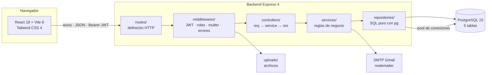
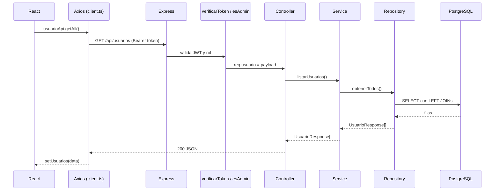
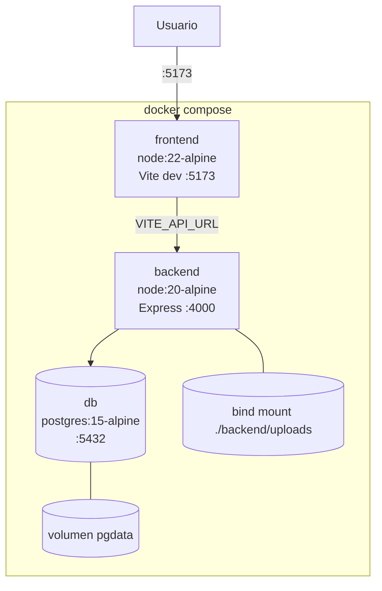
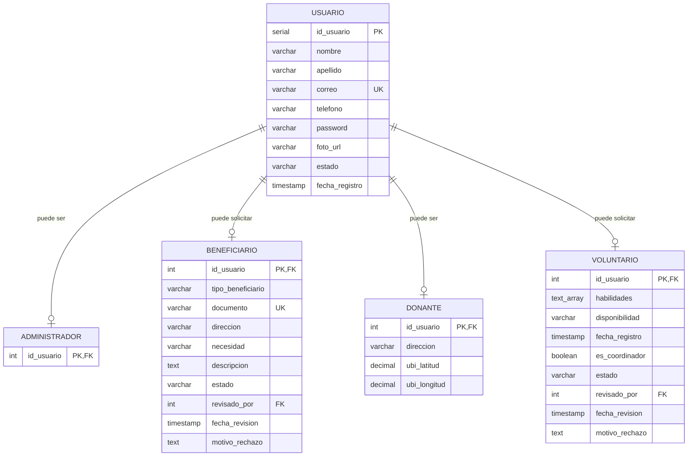

<div align="center">

# 🤝 Sistema de Donaciones y Voluntariados

**Plataforma para conectar donantes, voluntarios y beneficiarios.** Incluye autenticación, gestión de usuarios, Gestión de Donaciones con recepción, inventario central, fotografías y reportes, Campañas y Actividades, y el módulo de Gestión de Beneficiarios y Ayudas. Interfaz accesible en modo claro y oscuro.


**Documento de onboarding técnico para equipos de desarrollo**

`Módulo de usuarios: preservado` · `Gestión de Donaciones: integrada` · `Inventario: integrado` · `Campañas: integradas` · `Beneficiarios y Ayudas: integrado`

</div>

---

> [!IMPORTANT]
> **Antes de escribir código, leé las secciones [5](#5-arquitectura), [9](#9-backend), [11](#11-frontend) y [17](#17-guía-para-equipos).**
> Este README es el contrato técnico del proyecto: describe cómo está construido, qué funciona hoy, qué falta y cómo deben integrarse los nuevos módulos sin romper lo existente.

---

## Tabla de contenidos

1. [Visión general](#1-visión-general)
2. [Inicio rápido](#2-inicio-rápido)
3. [Estado actual del proyecto](#3-estado-actual-del-proyecto)
4. [Roles y permisos](#4-roles-y-permisos)
5. [Arquitectura](#5-arquitectura)
6. [Stack tecnológico](#6-stack-tecnológico)
7. [Estructura del proyecto](#7-estructura-del-proyecto)
8. [Base de datos](#8-base-de-datos)
9. [Backend](#9-backend)
10. [Referencia de la API](#10-referencia-de-la-api)
11. [Frontend](#11-frontend)
12. [Sistema de diseño](#12-sistema-de-diseño)
13. [Pantallas y rutas](#13-pantallas-y-rutas)
14. [Puesta en marcha](#14-puesta-en-marcha)
15. [Usuarios de prueba](#15-usuarios-de-prueba)
16. [Comandos útiles](#16-comandos-útiles)
17. [Guía para equipos](#17-guía-para-equipos)
18. [Deuda técnica y roadmap](#18-deuda-técnica-y-roadmap)
19. [Troubleshooting](#19-troubleshooting)
20. [Glosario](#20-glosario)

---

## 1. Visión general

### 1.1 Qué es

Una plataforma web para gestionar el ciclo completo de la ayuda solidaria:

- **Donantes** registran donaciones en especie o aportes y reciben trazabilidad.
- **Voluntarios** se postulan a campañas y jornadas según sus habilidades y disponibilidad.
- **Beneficiarios** (persona, familia o institución) publican necesidades y son validados por un administrador.
- **Administradores** gestionan cuentas, campañas, donaciones, pagos y reportes.

### 1.2 Qué resuelve hoy

| Módulo | Estado | Alcance real |
|---|---|---|
| Autenticación | ✅ Implementado | Registro público de donante, login JWT, sesión con expiración, cierre por inactividad |
| Recuperación de contraseña | ✅ Implementado | Solicitud por correo, token de 1 hora, validación y reset |
| Gestión de usuarios | ✅ Implementado | CRUD admin, roles, subtipos, activar/desactivar, borrado lógico, filtros y paginación |
| Perfil propio | ✅ Implementado | Datos personales, contraseña, foto persistida en `usuario.foto_url` y ubicación propia del donante |
| Dashboard | 🟡 Parcialmente implementado | Postulaciones y bandejas de aprobación; KPIs de muestra y módulos de negocio deshabilitados |
| Campañas | ⛔ Pendiente | Solo tarjetas "En desarrollo" |
| Donaciones y pagos QR | ⛔ Pendiente | Sin tablas ni endpoints |
| Gestión de convocatorias y turnos de voluntariado | ⛔ Pendiente | La postulación y aprobación del rol Voluntario sí existen; faltan convocatorias, asignaciones y asistencia |
| Reportes / exportaciones | ⛔ Pendiente | Dependencias instaladas (`xlsx`, `jspdf`, `@nivo/*`) pero sin uso |

### 1.3 Principios de diseño del sistema

1. **Separación por capas:** el controlador no sabe SQL; el repositorio no sabe HTTP.
2. **SQL puro y explícito:** sin ORM, con `pg` y transacciones donde se escribe en varias tablas.
3. **Contrato tipado:** `models/` y `types/` definen el vocabulario compartido.
4. **Errores centralizados:** `AppError` para negocio, `errorMiddleware` para traducir a HTTP.
5. **Tokens semánticos de diseño:** los componentes no usan hex; usan `bg-surface`, `text-text-muted`, etc.
6. **Accesibilidad y móvil primero:** contraste AA, foco visible, áreas táctiles, `safe-area`, reduced motion.

---

## Módulo integrado: Gestión de Donaciones

La ruta privada `/donaciones` reutiliza el JWT y los roles canónicos existentes (Administrador, Donante, Voluntario y Beneficiario). El módulo incorpora registro, recepción, comprobantes, fotografías privadas, auditoría, reportes e inventario central. Los bienes aceptados en una recepción física ingresan automáticamente a `inventario` mediante un trigger PostgreSQL.

Las tablas `inventario_destino` y sus columnas `campana_id` / `solicitud_ayuda_id` enlazan la salida usando `id_inventario` + `id_donacion` + exactamente uno de los destinos. Campañas y Solicitudes de Ayuda ya cuentan con tablas, endpoints y claves foráneas; Donaciones solo consume sus contratos de lectura. Las reglas de salida están en `docs/INTEGRACION_CAMPANAS_SOLICITUDES.md` y el módulo de ayudas en `docs/AYUDAS.md`.

**Base de datos:** el esquema y los seeds están en `database/01_schema.sql`, `database/02_inserts.sql` y `database/03_solicitudes_ayuda.sql`. En una base nueva, Docker ejecuta los tres archivos en orden. Si ya existe un volumen PostgreSQL, no vuelvas a ejecutar completos `01_schema.sql` ni `02_inserts.sql`: `01_schema.sql` contiene los `CREATE TABLE` originales de Usuarios. Haz backup y aplica por separado únicamente los bloques nuevos o el script `03_solicitudes_ayuda.sql`; para catálogos, ejecuta únicamente el bloque final `4. CATÁLOGOS INICIALES` de `02_inserts.sql`. Así no se duplican tablas ni usuarios.

**Fotografías:** JPG, PNG o WEBP, máximo 5 archivos de 5 MB por envío; se guardan en `backend/storage/donaciones`, fuera de la carpeta pública. En Docker el volumen `./backend/storage:/app/storage` conserva los archivos.

---

## 2. Inicio rápido

### 2.1 Requisitos

| Herramienta | Versión mínima |
|---|---|
| Node.js | 20 LTS |
| npm | 10 |
| Docker Desktop | última estable (con Compose v2) |
| Git | cualquiera reciente |

### 2.2 Los 6 pasos

```powershell
# 1. Clonar
git clone https://github.com/T-T-MoY/Sistema_de_Donaciones_y_Voluntarios.git
cd Sistema_de_Donaciones_y_Voluntarios

# 2. Crear el .env de la raíz (ver sección 14.2)
#    Debe existir antes de levantar Docker.

# 3. Levantar solo PostgreSQL
docker compose up -d db

# 4. Backend (terminal 1)
cd backend
npm install
npm run dev

# 5. Frontend (terminal 2; API_URL tiene fallback local)
cd frontend
npm install
npm run dev

# 6. Abrir http://localhost:5173
```

> Para configurar otra URL de API, crear `frontend/.env` con `VITE_API_URL`. En desarrollo local, el cliente compartido usa `http://localhost:4000/api` como fallback; recuperación de contraseña usa la URL configurada.

### 2.3 URLs

| Servicio | URL |
|---|---|
| Frontend | http://localhost:5173 |
| API | http://localhost:4000/api |
| Health check | http://localhost:4000/api/health |
| Documentación de API | Este README (no hay Swagger/OpenAPI todavía) |

### 2.4 Verificación en 30 segundos

```powershell
# Health check
Invoke-RestMethod http://localhost:4000/api/health

# Login de prueba
$body = @{ "correo" = "carla.admin@donacionesbo.org"; "contraseña" = "Passw123" } | ConvertTo-Json
$login = Invoke-RestMethod -Method Post -Uri http://localhost:4000/api/auth/login `
  -ContentType "application/json; charset=utf-8" -Body $body
$login.usuario

# Listado de usuarios (requiere token)
Invoke-RestMethod http://localhost:4000/api/usuarios `
  -Headers @{ Authorization = "Bearer $($login.token)" }
```

Si el health check responde y el login devuelve un `token`, el entorno está operativo.

---

## 3. Estado actual del proyecto

### 3.1 Lo que está listo para usar

- Registro público con selección de rol: **Donante**, **Beneficiario** o **Voluntario**. Las solicitudes de voluntariado quedan pendientes de aprobación; las de beneficiario quedan pendientes de verificación.
- Login con JWT y validación de cuenta activa.
- Recuperación de contraseña con envío por SMTP (Gmail).
- Panel de administración de usuarios:
  - listado completo (sin paginación de servidor),
  - búsqueda por nombre/apellido/correo,
  - filtros por rol y estado,
  - paginación en cliente (5/10/20/50),
  - crear, editar, activar/desactivar y eliminar (borrado lógico),
  - formulario específico por rol.
- Perfil propio con actualización de datos, contraseña y foto (archivo guardado en `backend/uploads/perfiles` y ruta persistida en `usuario.foto_url`).
- Ubicación propia para cuentas donantes, guardada en `donante.ubi_latitud`/`ubi_longitud` y visible en el mapa del perfil.
- Postulación desde el Dashboard para ser voluntario o beneficiario, más bandejas de revisión: coordinador/admin para voluntariado y admin para beneficiarios.
- Tema claro/oscuro persistente.
- Landing pública con secciones informativas.
- Docker Compose para base de datos, backend y frontend.
- Análisis estático con SonarQube (script incluido).

### 3.2 Lo que existe solo como UI

- Dashboard con KPIs de muestra y tarjetas de campañas/donaciones/reportes aún deshabilitadas.
- Sidebar con seis módulos e iconos; solo Gestión de Usuarios tiene una pantalla operativa. Los módulos 2–6 aparecen como enlaces de desarrollo sin rutas registradas.

### 3.3 Lo que no existe todavía

- Tablas y endpoints de campañas, donaciones, pagos, comprobantes, convocatorias, asignaciones/turnos y reportes.
- Notificaciones en tiempo real.
- Tests automatizados, linter y pipeline CI.
- OpenAPI/Swagger y colección Postman versionada.

---

## 4. Roles y permisos

### 4.1 Nombres canónicos

El sistema tiene cuatro subtipos en las tablas de roles. En las respuestas y el JWT puede aparecer **Coordinador**, que es un voluntario aprobado con `es_coordinador = true`:

| Rol canónico (API/JWT) | Alias aceptados de entrada | Alias heredado del frontend | Tabla de subtipo |
|---|---|---|---|
| `Administrador` | `admin`, `administrador` | `Admin` | `administrador` |
| `Coordinador` | `coordinador` | `Coordinador` | `voluntario` (`es_coordinador = true`) |
| `Beneficiario` | `beneficiario` | `Beneficiario` | `beneficiario` |
| `Donante` | `donante`, `cliente` | `Cliente` | `donante` |
| `Voluntario` | `voluntario`, `empleado` | `Empleado` | `voluntario` |

El administrador crea coordinadores desde el formulario de usuario al seleccionar el rol de voluntario y activar la opción de coordinador. El esquema exige que todo coordinador esté aprobado.

### 4.2 Matriz de permisos

| Acción | Público | Donante | Voluntario | Coordinador | Beneficiario | Administrador |
|---|:---:|:---:|:---:|:---:|:---:|:---:|
| Ver landing | ✅ | ✅ | ✅ | ✅ | ✅ | ✅ |
| Registrarse como Donante, Beneficiario o Voluntario | ✅ | — | — | — | — | — |
| Ver y editar perfil propio / foto | — | ✅ | ✅ | ✅ | ✅ | ✅ |
| Enviar solicitud de voluntariado o beneficiario | — | ✅ | ✅ | ✅ | ✅ | ✅ |
| Revisar solicitudes de voluntariado | — | — | — | ✅ | — | ✅ |
| Revisar solicitudes de beneficiario | — | — | — | — | — | ✅ |
| Listar, crear, editar y desactivar usuarios | — | — | — | — | — | ✅ |
| Eliminar usuario (lógico) | — | — | — | — | — | ✅ |

El esquema actual no tiene niveles `SUPERADMIN`/`GENERAL`; todas las cuentas de administrador usan el mismo middleware.

### 4.3 Estados de cuenta

| Estado | Significado | Puede iniciar sesión | Aparece en listados |
|---|---|:---:|:---:|
| `Activo` | Cuenta operativa | ✅ | ✅ |
| `Inactivo` | Desactivada temporalmente | ❌ (403) | ✅ |
| `Eliminado` | Borrado lógico, conserva historial | ❌ (401) | ❌ |

Reglas:

- `PUT /api/usuarios/estado/:id` solo permite `Activo`/`Inactivo`.
- `DELETE /api/usuarios/:id` marca `Eliminado`; no borra filas.
- Al crear/editar, el estado `Eliminado` no se puede asignar desde la API.

### 4.4 Estado de verificación del beneficiario

Independiente del estado de cuenta:

`Pendiente` → `Verificado` | `Rechazado`

Se revisa en la bandeja del Dashboard para administradores. La solicitud pendiente de beneficiario se crea con la cuenta activa; el estado de verificación se guarda por separado.

### 4.5 Estado de voluntariado

`Pendiente` → `Aprobado` | `Rechazado`

El coordinador de voluntarios o un administrador revisa la solicitud desde el Dashboard. El registro público crea la cuenta inactiva hasta su aprobación; rechazarla la mantiene inactiva. Un coordinador debe estar aprobado y no puede revisar su propia solicitud.

---

## 5. Arquitectura

### 5.1 Vista general



### 5.2 Regla de dependencias del backend

```text
routes → middlewares → controllers → services → repositories → PostgreSQL
                                      ↘ utils / models / config
```

- **Nunca** al revés.
- `controllers` no importa `pg` ni ejecuta SQL.
- `services` no conoce `req` ni `res`.
- `repositories` es el único lugar con SQL de su dominio.
- `models` solo contiene tipos e interfaces.

### 5.3 Capas del backend

| Carpeta | Responsabilidad | Archivos actuales |
|---|---|---|
| `config/` | Conexión a PostgreSQL y SMTP | `database.ts`, `mailer.ts` |
| `routes/` | Declaración de rutas y middlewares por endpoint | `authRoutes.ts`, `userRoutes.ts` |
| `middlewares/` | Autenticación, autorización, errores, utilidades | `authMiddleware.ts`, `errorMiddleware.ts`, `asyncHandler.ts` |
| `controllers/` | Traducir HTTP a llamadas de servicio | `authController.ts`, `userController.ts` |
| `services/` | Reglas de negocio y validación | `authService.ts`, `usuarioService.ts`, `emailService.ts` |
| `repositories/` | Acceso a datos y transacciones | `usuarioRepository.ts` |
| `models/` | Tipos de dominio y DTOs | `usuarioModel.ts` |
| `validators/` | Validaciones HTTP opcionales | `usuarioValidator.ts` (hoy sin uso) |
| `utils/` | Errores y validaciones reutilizables | `AppError.ts`, `validaciones.ts` |
| `types/` | Extensión de tipos de Express | `express.d.ts` |

### 5.4 Ciclo de una petición autenticada



### 5.5 Arquitectura del frontend

```text
main.tsx
└── ThemeProvider            (tema claro/oscuro + localStorage)
    └── ToastProvider        (notificaciones globales)
        └── AuthProvider     (token JWT + usuario decodificado + AFK)
            └── App          (BrowserRouter)
                ├── PublicLayout      → LandingNavbar + Footer
                ├── Auth pages        → Login / Registro / Recuperación
                └── RutasProtegidas
                    └── AppLayout     → Navbar lateral + Header
                        ├── Dashboard
                        ├── Perfil
                        └── RutasAdmin
                            └── Usuarios
```

| Capa | Responsabilidad |
|---|---|
| `pages/` | Composición de pantallas completas |
| `components/layout/` | Chrome de la app: navbar, header, footer, layouts |
| `components/ui/` | Piezas reutilizables: modales, errores de campo, toggle de tema |
| `components/usuarios/` | Dominio de usuarios: lista, card, modal |
| `components/guards/` | Protección de rutas por sesión y rol |
| `context/` | Estado global: auth, tema, toasts |
| `hooks/` | Lógica reutilizable: usuarios, foto, auth |
| `api/` | Cliente Axios y funciones por dominio |
| `types/` | Contratos TypeScript |
| `utils/` | Validaciones y formateo |

### 5.6 Topología de despliegue



> El `frontend` de Compose corre **Vite en modo desarrollo** dentro del contenedor, no un build estático servido por Nginx. Para producción real falta una etapa de build + servidor estático.

---

## 6. Stack tecnológico

### 6.1 Backend

| Tecnología | Versión | Uso |
|---|---|---|
| Node.js | 20 | Runtime |
| Express | 4.19 | Framework HTTP |
| TypeScript | 5.4 | Tipado estricto, compilado a CommonJS |
| `pg` | 8.11 | Pool de conexiones y SQL puro |
| `jsonwebtoken` | 9.0 | Emisión y verificación de JWT |
| `bcrypt` | 5.1 | Hash de contraseñas (10 rondas) |
| `multer` | 1.4 | Subida de archivos (foto de perfil) |
| `nodemailer` | 6.9 | Envío de correo por Gmail SMTP |
| `cors` | 2.8 | CORS restringido a `FRONTEND_URL` |
| `dotenv` | 16.4 | Variables de entorno |
| `ts-node` + `nodemon` | 10 / 3 | Hot reload en desarrollo |

### 6.2 Frontend

| Tecnología | Versión | Uso |
|---|---|---|
| React | 18.2 | UI |
| Vite | 8.2 | Bundler y dev server |
| TypeScript | 5.4 | Tipado estricto |
| React Router | 7.18 | Ruteo SPA |
| Axios | 1.6 | Cliente HTTP e interceptores |
| Tailwind CSS | 4.3 | Estilos mediante `@theme` y utilidades |
| `@tailwindcss/vite` | 4.3 | Plugin oficial, sin PostCSS |
| `jwt-decode` | 4.0 | Lectura del payload JWT en cliente |
| `vite-plugin-svgr` | 5.2 | Importar SVG como componente React |

### 6.3 Dependencias instaladas sin uso actual

`@nivo/pie`, `@nivo/heatmap`, `jspdf`, `html2canvas`, `xlsx`.

Están previstas para reportes/exportaciones. Si no se usarán a corto plazo, conviene retirarlas para reducir superficie de dependencias.

### 6.4 Infraestructura y calidad

| Herramienta | Uso |
|---|---|
| Docker Compose | Orquestación local de db + backend + frontend |
| PostgreSQL 15 Alpine | Base de datos, TZ `America/La_Paz` |
| SonarQube (local :9000) | Análisis estático de backend y frontend |
| `scan-sonar.ps1` | Ejecuta el scanner en contenedor |

> No hay ESLint, Prettier, Vitest, Jest ni pipeline CI configurados. Los únicos chequeos automáticos son `tsc` y Sonar.

---

## 7. Estructura del proyecto

```text
Sistema de Donaciones y Voluntariados/
├── compose.yaml                 # db + backend + frontend
├── .env                         # NO versionado; lo usa Compose y el backend
├── .gitignore
├── README.md
├── scan-sonar.ps1               # Scanner SonarQube en Docker
│
├── database/
│   ├── 01_schema.sql            # 5 tablas, checks, FKs e índices
│   └── 02_inserts.sql           # 12 usuarios de prueba
│
├── backend/
│   ├── Dockerfile               # node:20-alpine, build + start
│   ├── package.json
│   ├── tsconfig.json
│   ├── sonar-project.properties
│   ├── docs/usuarios.http       # reservado; actualmente vacío
│   ├── uploads/                 # volumen de archivos (runtime)
│   └── src/
│       ├── server.ts            # único app.listen + graceful shutdown
│       ├── app.ts               # Express, CORS, rutas, 404 y errores
│       ├── config/
│       │   ├── database.ts      # Pool pg + traducción db→localhost
│       │   └── mailer.ts        # transporter Gmail
│       ├── controllers/
│       │   ├── authController.ts
│       │   └── userController.ts
│       ├── services/
│       │   ├── authService.ts
│       │   ├── usuarioService.ts
│       │   └── emailService.ts
│       ├── repositories/
│       │   └── usuarioRepository.ts
│       ├── models/
│       │   └── usuarioModel.ts
│       ├── routes/
│       │   ├── authRoutes.ts
│       │   └── userRoutes.ts
│       ├── middlewares/
│       │   ├── authMiddleware.ts
│       │   ├── errorMiddleware.ts
│       │   └── asyncHandler.ts
│       ├── validators/
│       │   └── usuarioValidator.ts
│       ├── utils/
│       │   ├── AppError.ts
│       │   └── validaciones.ts
│       └── types/
│           └── express.d.ts
│
└── frontend/
    ├── Dockerfile               # node:22-alpine + Vite dev
    ├── index.html               # fuentes, meta theme-color, viewport
    ├── package.json
    ├── vite.config.ts           # react + tailwind + svgr + proxy /api
    ├── tsconfig.json
    ├── sonar-project.properties
    ├── public/
    │   ├── favicon.svg
    │   └── images/auth-complex.jpg
    └── src/
        ├── main.tsx             # providers + App
        ├── App.tsx              # rutas
        ├── index.css            # @theme, tokens, keyframes, utilidades
        ├── assets/logo.svg
        ├── api/
        │   ├── client.ts        # Axios + Bearer + interceptor 401/403
        │   ├── auth.api.ts
        │   └── usuario.api.ts
        ├── context/
        │   ├── AuthContext.tsx
        │   ├── ThemeContext.tsx
        │   └── ToastContext.tsx
        ├── hooks/
        │   ├── useAuth.ts
        │   ├── useUsuarios.ts
        │   └── useFotoPerfil.ts
        ├── components/
        │   ├── landing/         # Hero, HowItWorks, ServicesShowcase
        │   ├── layout/          # PublicLayout, AppLayout, Navbar, Header, Footer, LandingNavbar
        │   ├── mapa/            # MiUbicacion, mapa Leaflet y utilidades
        │   ├── usuarios/        # UsuarioList, UsuarioCard, UsuarioModal
        │   ├── guards/          # RutasProtegidas, RutasAdmin
        │   └── ui/              # ConfirmModal, FieldError, Reveal, ThemeToggle
        ├── pages/
        │   ├── Home.tsx
        │   ├── Login.tsx
        │   ├── Registro.tsx
        │   ├── SolicitarRecuperacion.tsx
        │   ├── ResetPassword.tsx
        │   ├── Dashboard.tsx
        │   ├── Perfil.tsx
        │   └── UsuariosPage.tsx
        ├── types/
        │   ├── auth.types.ts
        │   └── usuario.types.ts
        └── utils/
            ├── formatDate.ts
            └── validaciones.ts  # espejo del backend
```

---

## 8. Base de datos

### 8.1 Modelo de herencia 1:1



Las tablas de subtipo permiten que un usuario acumule participaciones. El formulario de alta/edición del administrador mantiene un solo rol por usuario y limpia los demás subtipos al cambiarlo; las postulaciones desde el Dashboard pueden agregar o actualizar el subtipo voluntario o beneficiario sin quitar el de donante.

### 8.2 Tablas

#### `usuario` (entidad padre)

| Columna | Tipo | Restricciones |
|---|---|---|
| `id_usuario` | `SERIAL` | PK |
| `nombre` | `VARCHAR(100)` | NOT NULL |
| `apellido` | `VARCHAR(100)` | NOT NULL |
| `correo` | `VARCHAR(150)` | NOT NULL, UNIQUE |
| `telefono` | `VARCHAR(20)` | opcional |
| `password` | `VARCHAR(255)` | NOT NULL (hash bcrypt) |
| `foto_url` | `VARCHAR(500)` | opcional; ruta de la foto de perfil |
| `estado` | `VARCHAR(20)` | NOT NULL, default `Activo`; CHECK `Activo`/`Inactivo`/`Eliminado` |
| `fecha_registro` | `TIMESTAMP` | NOT NULL, default `CURRENT_TIMESTAMP` |

> El esquema guarda **un solo apellido**. La API lo divide en `paterno` y `materno` por el primer espacio y los vuelve a unir al escribir. Ver limitaciones en 18.3.

#### `administrador`

| Columna | Tipo | Restricciones |
|---|---|---|
| `id_usuario` | `INT` | PK, FK → `usuario` ON DELETE CASCADE |

#### `beneficiario`

| Columna | Tipo | Restricciones |
|---|---|---|
| `id_usuario` | `INT` | PK, FK → `usuario` ON DELETE CASCADE |
| `tipo_beneficiario` | `VARCHAR(30)` | CHECK `Persona`/`Familia`/`Institucion` |
| `documento` | `VARCHAR(30)` | NOT NULL, UNIQUE (CI, NIT o personería) |
| `direccion` | `VARCHAR(255)` | NOT NULL |
| `necesidad` | `VARCHAR(150)` | NOT NULL |
| `descripcion` | `TEXT` | opcional |
| `estado` | `VARCHAR(20)` | default `Pendiente`; CHECK `Pendiente`/`Verificado`/`Rechazado` |
| `revisado_por` | `INT` | FK a `usuario`; se limpia al borrar al revisor |
| `fecha_revision` | `TIMESTAMP` | opcional |
| `motivo_rechazo` | `TEXT` | opcional |

#### `donante`

| Columna | Tipo | Restricciones |
|---|---|---|
| `id_usuario` | `INT` | PK, FK → `usuario` ON DELETE CASCADE |
| `direccion` | `VARCHAR(255)` | opcional |
| `ubi_latitud` | `DECIMAL(10,8)` | opcional, entre -90 y 90 |
| `ubi_longitud` | `DECIMAL(11,8)` | opcional, entre -180 y 180 |

#### `voluntario`

| Columna | Tipo | Restricciones |
|---|---|---|
| `id_usuario` | `INT` | PK, FK → `usuario` ON DELETE CASCADE |
| `habilidades` | `TEXT[]` | NOT NULL, default `{}` |
| `disponibilidad` | `VARCHAR(100)` | NOT NULL |
| `fecha_registro` | `TIMESTAMP` | default `CURRENT_TIMESTAMP` |
| `es_coordinador` | `BOOLEAN` | NOT NULL, default `false`; requiere estado `Aprobado` |
| `estado` | `VARCHAR(20)` | default `Pendiente`; CHECK `Pendiente`/`Aprobado`/`Rechazado` |
| `revisado_por` | `INT` | FK a `usuario`; no puede ser el mismo voluntario |
| `fecha_revision` | `TIMESTAMP` | opcional |
| `motivo_rechazo` | `TEXT` | opcional |

### 8.3 Índices

```sql
usuario.correo                -- UNIQUE (crea índice automáticamente)
idx_usuario_estado            -- filtros por estado
idx_beneficiario_documento    -- unicidad operativa / búsqueda
idx_beneficiario_estado       -- verificación de beneficiarios
```

### 8.4 Datos de prueba

`02_inserts.sql` carga **12 usuarios** (2 admin, 3 beneficiarios, 4 donantes, 3 voluntarios) y sincroniza la secuencia de IDs.

> El comentario del SQL dice que la contraseña es `123456`, pero el hash corresponde a **`Passw123`** (verificado). La tabla de la sección 15 es la fuente de verdad.

### 8.5 Migraciones y cambios de esquema

No hay herramienta de migraciones. Los scripts se aplican **solo cuando el volumen de PostgreSQL está vacío** (comportamiento de `docker-entrypoint-initdb.d`).

Convención para equipos:

1. Crear `database/03_descripcion_corta.sql`, `04_...`, etc.
2. Nunca editar `01_schema.sql` si ya hay entornos con datos; agregar un script nuevo.
3. Para entornos existentes, aplicar el script manualmente:

```powershell
Get-Content database\03_mi_cambio.sql |
  docker exec -i postgres-db-donaciones_y_voluntariado `
  psql -U <DB_USER> -d <DB_NAME>
```

4. Documentar el cambio en el PR y actualizar este README si afecta el contrato.

> [!CAUTION]
> `docker compose down -v` **borra todos los datos** (volumen `pgdata`). Usalo solo en desarrollo local.

---

## 9. Backend

### 9.1 Arranque

- `src/server.ts` es el **único** archivo que llama a `app.listen()`.
- Verifica la conexión a PostgreSQL con `SELECT NOW()` antes de escuchar.
- En `NODE_ENV=production`, si la BD no responde, aborta.
- En desarrollo, arranca igual y muestra una advertencia.
- Implementa cierre ordenado con `SIGINT`/`SIGTERM`, cierra el pool y fuerza salida a los 10 s.

`src/app.ts` configura:

1. `x-powered-by` deshabilitado.
2. CORS restringido a `FRONTEND_URL` (default `http://localhost:5173`).
3. `express.json()`.
4. Estáticos en `/uploads`.
5. Logger simple por consola.
6. Health check.
7. Rutas `/api/auth` y `/api/usuarios`.
8. Ruta raíz informativa.
9. `notFoundMiddleware` y `errorMiddleware`.

### 9.2 Configuración de entorno

El backend carga, en este orden:

1. `.env` de la raíz (`backend/src/config` → `../../../.env`).
2. `.env` propio de `backend/` si existe.
3. Variables del proceso.

Si `DB_HOST=db` y **no** está dentro de Docker, se traduce automáticamente a `localhost`. Esto permite usar el mismo `.env` en local y en Compose.

Pool de PostgreSQL:

| Parámetro | Valor |
|---|---|
| `max` | 20 clientes |
| `idleTimeoutMillis` | 30 s |
| `connectionTimeoutMillis` | 5 s |

Si un cliente inactivo falla, el proceso termina (`process.exit(-1)`).

### 9.3 Autenticación y sesión

- Algoritmo: JWT firmado con `JWT_SECRET`, expiración **8 horas**.
- Payload:

```json
{
  "id": 1,
  "id_usuario": 1,
  "nombre": "Carla",
  "apellido": "Mamani Quispe",
  "correo": "carla.admin@donacionesbo.org",
  "rol": "Administrador",
  "iat": 1760000000,
  "exp": 1760028800
}
```

- El cliente guarda el token en `localStorage` con la clave `token`.
- Se envía como `Authorization: Bearer <token>`.
- El frontend decodifica el JWT con `jwt-decode` y cierra sesión si `exp` ya pasó.
- **AFK:** cierre automático tras **15 minutos** sin `mousemove`, `keydown`, `click` o `scroll`.
- El interceptor de Axios elimina el token y redirige a `/login` ante **401 o 403**.

> [!WARNING]
> El interceptor trata cualquier **403** como sesión expirada. Si un usuario autenticado sin permisos llama a un endpoint admin, pierde la sesión. Unificar el manejo de 403 es deuda técnica prioritaria.

### 9.4 Middlewares

| Middleware | Qué hace |
|---|---|
| `verificarToken` | Lee `Authorization`, valida JWT, asigna `req.usuario`; 401 si falta/expira, 403 si es inválido |
| `esAdmin` | Exige rol `admin` o `administrador`; 403 en caso contrario |
| `esAdminOEmpleado` | Legado, sin uso |
| `esCliente` | Legado, sin uso |
| `errorMiddleware` | Traduce `AppError`, errores PostgreSQL y Multer a JSON |
| `notFoundMiddleware` | 404 uniforme para rutas inexistentes |
| `asyncHandler` | Envuelve handlers async; hoy sin uso porque los controllers usan `try/catch` |

### 9.5 Validaciones de negocio

Viven en `backend/src/utils/validaciones.ts` y se invocan desde los servicios.

| Campo | Regla |
|---|---|
| `nombre` | 2–50 caracteres, solo letras/espacios/apóstrofes/guiones |
| `paterno` | 2–50, obligatorio, solo letras |
| `materno` | 2–50, opcional, solo letras |
| `correo` | Formato estándar, máx. 150 caracteres |
| `telefono` | Exactamente 8 dígitos numéricos (formato Bolivia) |
| `contraseña` | 8–100 caracteres, al menos 1 mayúscula, 1 minúscula y 1 número |
| `ci_nit` / `documento` | 5–15 dígitos numéricos |
| `tipo_beneficiario` | `Persona`, `Familia`, `Institucion` |
| `direccion` (beneficiario) | Obligatoria, máx. 255 |
| `necesidad` | Obligatoria, máx. 150 |
| `descripcion` | Opcional, máx. 2000 |
| `estado_beneficiario` | `Pendiente`, `Verificado`, `Rechazado` |
| `habilidades` | Al menos 1, máx. 20, cada una ≤ 60 caracteres; acepta string separado por comas o array |
| `disponibilidad` | Obligatoria, máx. 100 |
| `nivel_acceso` | Validación heredada; no existe como columna en `administrador` |
| Coordenadas | Latitud -90..90, longitud -180..180; si una viene, ambas |

> El login solo exige contraseña de **6+ caracteres** por compatibilidad histórica, no la política completa. Ver 18.3.

### 9.6 Errores

`AppError(message, statusCode)` se lanza desde los servicios y se traduce en `errorMiddleware`:

| Caso | Status | Cuerpo |
|---|---|---|
| Validación / duplicado | 400 | `{ "error": "mensaje" }` |
| Credenciales inválidas / sin token | 401 | `{ "error": "mensaje" }` |
| Cuenta desactivada / sin permisos | 403 | `{ "error": "mensaje" }` |
| No encontrado | 404 | `{ "error": "mensaje" }` |
| Error inesperado | 500 | `{ "error": "Error interno del servidor" }` (en dev, mensaje real) |
| Ruta inexistente | 404 | `{ "success": false, "message": "La ruta [METHOD] /url no existe..." }` |

Errores PostgreSQL traducidos:

- `23505` + constraint de `correo` → `El correo ya está registrado`.
- `23505` + constraint de `documento` → `El documento (CI / NIT) ya está registrado`.
- `23505` genérico → `Datos duplicados`.

Errores Multer → `Archivo inválido o demasiado grande (máx. 5MB).`

> [!NOTE]
> Hay dos formatos de error: `{ error }` para la API de negocio y `{ success, message }` para el 404 global. Al construir nuevos módulos, usá `{ error }` y `AppError`.

### 9.7 Carga de archivos

- Endpoint: `PUT /api/usuarios/perfil`.
- Campo: `foto`.
- Destino: `./uploads/perfiles` (relativo al cwd del backend).
- Nombre: `Date.now() + extensión original`.
- Filtro: `mimetype` debe empezar con `image/`.
- Límite: **5 MB**.
- Servido públicamente en `GET /uploads/...`.

La ruta del archivo se guarda en `usuario.foto_url` y se sirve desde `/uploads`. El nombre actual se construye con `Date.now()` y el filtro valida el MIME declarado por el cliente.

### 9.8 Correo

`emailService.enviarRecuperacionPassword` arma un HTML con el enlace:

```text
${FRONTEND_URL}/reset-password?token=${token}
```

- Token aleatorio de 32 bytes en hexadecimal.
- Expira en **1 hora**.
- Si el envío falla, el error se registra y el enlace se imprime en consola (modo desarrollo).
- La respuesta HTTP es idéntica exista o no el correo (anti-enumeración).

### 9.9 Cómo agregar un endpoint (receta)

1. **Modelo/tipos** en `models/<dominio>Model.ts`.
2. **Repositorio** en `repositories/<dominio>Repository.ts` (solo SQL, transacciones con `BEGIN/COMMIT/ROLLBACK`).
3. **Servicio** en `services/<dominio>Service.ts` (validaciones, reglas, `AppError`).
4. **Controlador** en `controllers/<dominio>Controller.ts` (`req → service → res`, `next(err)`).
5. **Rutas** en `routes/<dominio>Routes.ts` con `verificarToken` y el guard de rol.
6. **Montar** en `app.ts`: `app.use('/api/<dominio>', <dominio>Routes)`.
7. **Probar** con curl/PowerShell y actualizar la sección 10 de este README.
8. **Frontend:** `api/<dominio>.api.ts`, `types/<dominio>.types.ts`, hook, página y ruta.

Checklist de calidad:

- ¿El controlador quedó sin lógica de negocio?
- ¿El servicio no importa Express?
- ¿El repositorio usa parámetros `$1, $2...` (nunca interpolación)?
- ¿Las escrituras múltiples usan transacción?
- ¿Los errores usan `AppError`?
- ¿La respuesta sigue el contrato `{ mensaje, ...datos }`?

---

## 10. Referencia de la API

### 10.1 Convenciones

| Aspecto | Convención |
|---|---|
| Base URL | `http://localhost:4000/api` |
| Formato | JSON UTF-8; perfil acepta `multipart/form-data` |
| Auth | `Authorization: Bearer <JWT>` |
| Éxito | `200` / `201` con `{ mensaje?, ...datos }` |
| Error | `400/401/403/404/500` con `{ error }` |
| Fechas | ISO 8601 (`timestamp` de PostgreSQL) |
| Idioma | Campos, mensajes y rutas en español |
| Versión | Sin versionado (`/v1` no existe) |
| Paginación | No hay paginación de servidor; el listado devuelve todo |

### 10.2 Resumen de endpoints

| Método | Ruta | Auth | Rol | Descripción |
|---|---|---|:---:|---|
| `GET` | `/api/health` | No | — | Estado del backend |
| `POST` | `/api/auth/registrar` | No | — | Registro público de Donante, Beneficiario o Voluntario |
| `POST` | `/api/auth/login` | No | — | Login, devuelve JWT |
| `POST` | `/api/auth/solicitar-recuperacion` | No | — | Envía correo de recuperación |
| `GET` | `/api/auth/validar-token/:token` | No | — | Valida token de recuperación |
| `POST` | `/api/auth/reset-password` | No | — | Cambia contraseña con token |
| `GET` | `/api/usuarios/perfil` | Sí | Cualquiera | Perfil propio |
| `PUT` | `/api/usuarios/perfil` | Sí | Cualquiera | Actualiza perfil (multipart) |
| `GET` | `/api/usuarios/ubicaciones` | Sí | Cualquiera | Lista donantes con coordenadas guardadas |
| `POST` | `/api/usuarios/mi-ubicacion` | Sí | Cualquiera | Guarda las coordenadas propias |
| `POST` | `/api/usuarios/postular/donante` | Sí | Cualquiera | Habilita el subtipo Donante (sin revisión) |
| `POST` | `/api/usuarios/postular/voluntario` | Sí | Cualquiera | Envía/actualiza la solicitud de voluntariado |
| `POST` | `/api/usuarios/postular/beneficiario` | Sí | Cualquiera | Envía/actualiza la solicitud de beneficiario |
| `GET` | `/api/usuarios/solicitudes/voluntarios` | Sí | Coordinador o Admin | Lista solicitudes; acepta `?estado=` |
| `PATCH` | `/api/usuarios/solicitudes/voluntarios/:id` | Sí | Coordinador o Admin | Aprueba o rechaza una solicitud |
| `GET` | `/api/usuarios/solicitudes/beneficiarios` | Sí | Admin | Lista solicitudes; acepta `?estado=` |
| `PATCH` | `/api/usuarios/solicitudes/beneficiarios/:id` | Sí | Admin | Verifica o rechaza una solicitud |
| `GET` | `/api/usuarios` | Sí | Admin | Lista usuarios no eliminados |
| `POST` | `/api/usuarios` | Sí | Admin | Crea usuario con cualquier rol |
| `GET` | `/api/usuarios/:id` | Sí | Admin | Detalle de usuario |
| `PUT` | `/api/usuarios/:id` | Sí | Admin | Actualiza usuario |
| `PUT` | `/api/usuarios/estado/:id` | Sí | Admin | Activa/desactiva |
| `DELETE` | `/api/usuarios/:id` | Sí | Admin | Borrado lógico |
| `GET` | `/api/ayudas/beneficiarios` | Sí | Admin | Directorio de beneficiarios verificados; acepta `?q=` |
| `GET` | `/api/ayudas/solicitudes` | Sí | Admin o Beneficiario | Bandeja completa o historial propio; acepta `?estado=&tipo_ayuda=&q=` |
| `GET` | `/api/ayudas/solicitudes/:id` | Sí | Admin o Beneficiario propietario | Detalle con asignaciones de donaciones |
| `POST` | `/api/ayudas/solicitudes` | Sí | Admin o Beneficiario | Crea una solicitud `PENDIENTE` |
| `PATCH` | `/api/ayudas/solicitudes/:id/revision` | Sí | Admin | Aprueba o rechaza con motivo |
| `PATCH` | `/api/ayudas/solicitudes/:id/cierre` | Sí | Admin | Marca `ATENDIDA` o `CANCELADA` |

### 10.3 Autenticación

#### `POST /api/auth/registrar`

Registro público. Acepta `rol: "Donante"`, `rol: "Beneficiario"` o `rol: "Voluntario"`; si se omite, usa Donante. El registro de Administrador está bloqueado. Beneficiario requiere documento; tipo, necesidad y dirección tienen valores por defecto en el servicio. Voluntario permite omitir habilidades y disponibilidad, que reciben valores por defecto.

```json
{
  "nombre": "Ana",
  "paterno": "Pérez",
  "materno": "López",
  "correo": "ana.perez@example.com",
  "telefono": "71234567",
  "contraseña": "Passw123",
  "rol": "Donante",
  "ci_nit": "12345678",
  "calle": "Av. Arce 123",
  "zona": "Sopocachi",
  "ciudad": "La Paz"
}
```

**201**

```json
{
  "id_usuario": 13,
  "mensaje": "Cuenta de donante creada con éxito",
  "rol": "Donante",
  "estado": "Activo"
}
```

El formulario de registro solicita los datos específicos de cada rol. En la API, el beneficiario se crea con verificación pendiente y la cuenta activa; el voluntario queda inactivo hasta su aprobación. Errores: `400` validación/correo o documento duplicado, `403` si se intenta registrar un administrador.

#### Postulaciones y revisiones

Las postulaciones hechas desde el Dashboard requieren JWT. `POST /api/usuarios/postular/voluntario` acepta `habilidades` y `disponibilidad` (opcionales; usa `General` y `A convenir` por defecto). `POST /api/usuarios/postular/beneficiario` requiere `documento`, `direccion` y `necesidad`; `tipo_beneficiario` usa `Persona` por defecto y `descripcion` es opcional. Estas rutas agregan/actualizan el subtipo y dejan su estado en `Pendiente`.

`POST /api/usuarios/postular/donante` crea el subtipo Donante si aún no existe; es idempotente y no requiere aprobación porque el esquema no define un estado de solicitud para donantes. Las cuentas con rol Voluntario o Coordinador pueden habilitarlo desde el Dashboard.

Las bandejas aceptan filtro opcional `?estado=Pendiente`. Para revisar se envía `PATCH /api/usuarios/solicitudes/voluntarios/:id` con `{ "estado": "Aprobado" }` o `{ "estado": "Rechazado", "motivo_rechazo": "..." }`; coordinadores aprobados y administradores tienen acceso. Beneficiarios usan `PATCH /api/usuarios/solicitudes/beneficiarios/:id` con estado `Verificado` o `Rechazado`, solo para administradores. El revisor no puede revisar su propia solicitud.

#### Ubicación propia

`POST /api/usuarios/mi-ubicacion` recibe `{ "latitud": -16.5, "longitud": -68.1 }` (también acepta `lat`/`lng`) y actualiza las coordenadas del usuario autenticado en su subtipo donante. `GET /api/usuarios/ubicaciones` devuelve donantes con coordenadas para el mapa y requiere autenticación.

---

#### `POST /api/auth/login`

```json
{ "correo": "carla.admin@donacionesbo.org", "contraseña": "Passw123" }
```

**200**

```json
{
  "mensaje": "Inicio de sesión exitoso",
  "token": "eyJhbGciOi...",
  "usuario": {
    "id": 1,
    "id_usuario": 1,
    "nombre": "Carla",
    "apellido": "Mamani Quispe",
    "correo": "carla.admin@donacionesbo.org",
    "telefono": "71234567",
    "estado": "Activo",
    "rol": "Administrador"
  }
}
```

Errores:

| Status | Caso | Mensaje |
|---|---|---|
| 400 | Faltan campos / formato | `Correo y contraseña son obligatorios.` |
| 401 | Credenciales incorrectas | `Credenciales inválidas` |
| 401 | Cuenta eliminada | `Credenciales inválidas` |
| 403 | Cuenta inactiva | `Tu cuenta ha sido desactivada` |

---

#### `POST /api/auth/solicitar-recuperacion`

```json
{ "correo": "diego.ramirez@gmail.com" }
```

**200** (siempre, exista o no la cuenta)

```json
{ "mensaje": "Si el correo está registrado, te enviamos las instrucciones." }
```

> El token se guarda **en memoria** del proceso. Si el backend se reinicia, los enlaces pendientes dejan de funcionar. Ver 18.3.

---

#### `GET /api/auth/validar-token/:token`

**200**

```json
{ "valido": true, "correo": "diego.ramirez@gmail.com" }
```

| Status | Caso |
|---|---|
| 400 | Token expirado o vacío |
| 404 | Token inválido o ya usado |

---

#### `POST /api/auth/reset-password`

```json
{ "token": "a1b2c3...", "nuevaContraseña": "NuevaPass123" }
```

**200**

```json
{ "mensaje": "Contraseña actualizada con éxito" }
```

El token se elimina después del cambio. La nueva contraseña pasa la política completa.

---

### 10.4 Usuarios

#### `GET /api/usuarios/perfil`

**200** devuelve un `UsuarioResponse`:

```json
{
  "id_usuario": 6,
  "id": 6,
  "nombre": "Diego",
  "apellido": "Ramirez Soto",
  "apellidos": "Ramirez Soto",
  "paterno": "Ramirez",
  "materno": "Soto",
  "correo": "diego.ramirez@gmail.com",
  "telefono": "76002201",
  "estado": "Activo",
  "estado_cuenta": "Activo",
  "activo": true,
  "fecha_registro": "2026-02-05T15:00:00.000Z",
  "fecha_creacion": "2026-02-05T15:00:00.000Z",
  "rol": "Donante",
  "tipo_beneficiario": null,
  "documento": null,
  "ci_nit": null,
  "direccion": "Av. Busch #123, Miraflores, La Paz",
  "necesidad": null,
  "descripcion": null,
  "estado_beneficiario": null,
  "ubi_latitud": "-16.50384500",
  "ubi_longitud": "-68.12153200",
  "habilidades": [],
  "disponibilidad": null,
  "fecha_registro_voluntario": null
}
```

> `pg` devuelve `DECIMAL` como string; por eso `ubi_latitud`/`ubi_longitud` pueden llegar como texto. Los tipos del frontend aceptan `number | string | null`.
>
> `fecha_creacion` aparece como alias de compatibilidad en algunas respuestas; el nombre real de la columna es `fecha_registro`.

---

#### `PUT /api/usuarios/perfil`

`multipart/form-data` (también acepta campos de texto).

| Campo | Obligatorio | Notas |
|---|:---:|---|
| `nombre` | ✅ | |
| `paterno` | ✅ | |
| `materno` | ❌ | |
| `correo` | ✅ | Debe ser único |
| `telefono` | ✅ | 8 dígitos |
| `passwordActual` | Solo si cambia contraseña | |
| `passwordNueva` | Solo si cambia contraseña | Política completa |
| `foto` | ❌ | Imagen ≤ 5 MB; guarda su ruta en `usuario.foto_url` |
| `direccion` o `calle`+`zona`+`ciudad` | Según rol | Donante |
| `tipo_beneficiario`, `documento`/`ci_nit`, `direccion`, `necesidad`, `descripcion`, `estado_beneficiario` | Beneficiario | |
| `habilidades`, `disponibilidad` | Voluntario | `habilidades` puede ser string con comas |
| `ubi_latitud`, `ubi_longitud` | ❌ | Donante, ambas o ninguna |

**200**

```json
{
  "mensaje": "Perfil actualizado con éxito",
  "token": "eyJhbGciOi...",
  "perfil": { "...": "UsuarioResponse actualizado" }
}
```

El frontend reemplaza el token para reflejar nombre/correo actualizados.

---

#### `GET /api/usuarios` (admin)

Devuelve `UsuarioResponse[]` de todos los usuarios con `estado <> 'Eliminado'`, ordenados por `id_usuario DESC`. **Sin paginación.**

---

#### `POST /api/usuarios` (admin)

```json
{
  "nombre": "María",
  "paterno": "Quispe",
  "materno": "Loza",
  "correo": "maria.quispe@example.com",
  "telefono": "76543210",
  "contraseña": "Passw123",
  "rol": "Donante",
  "estado": "Activo",
  "calle": "Av. 6 de Agosto 200",
  "zona": "Sopocachi",
  "ciudad": "La Paz"
}
```

**201**

```json
{ "mensaje": "Usuario creado con éxito", "id_usuario": 13 }
```

Campos por rol:

| Rol | Campos específicos |
|---|---|
| `Administrador` | Sin campos adicionales en el esquema actual |
| `Beneficiario` | `tipo_beneficiario`, `documento` (5–15 dígitos, único), `direccion`, `necesidad`, `descripcion?`, `estado_beneficiario` |
| `Donante` | `direccion?`, `ubi_latitud?`, `ubi_longitud?` |
| `Voluntario` | `habilidades` (string con comas o array), `disponibilidad`; `es_coordinador` se configura desde la gestión administrativa y exige estado aprobado |

Acepta alias de rol (`Cliente`, `Empleado`, `Admin`).

---

#### `GET /api/usuarios/:id` (admin)

Devuelve un `UsuarioResponse`. `404` si no existe o está eliminado.

---

#### `PUT /api/usuarios/:id` (admin)

Mismos campos que creación. `contraseña` es opcional: si se omite, no se cambia.

Al cambiar de rol, el repositorio elimina las filas de los subtipos anteriores dentro de una transacción.

**200**

```json
{ "mensaje": "Usuario actualizado con éxito" }
```

---

#### `PUT /api/usuarios/estado/:id` (admin)

```json
{ "estado": "Inactivo" }
```

También acepta `true`/`false`.

**200**

```json
{
  "mensaje": "Estado actualizado",
  "usuario": {
    "id_usuario": 9,
    "nombre": "Paola",
    "correo": "paola.duran@gmail.com",
    "estado": "Inactivo"
  }
}
```

---

#### `DELETE /api/usuarios/:id` (admin)

Borrado lógico.

**200**

```json
{ "mensaje": "Usuario eliminado" }
```

No borra la fila: cambia `estado` a `Eliminado`. El usuario deja de aparecer en listados y no puede iniciar sesión.

---

### 10.5 Ejemplos con curl

```bash
# Login
TOKEN=$(curl -s -X POST http://localhost:4000/api/auth/login \
  -H "Content-Type: application/json" \
  -d '{"correo":"carla.admin@donacionesbo.org","contraseña":"Passw123"}' \
  | jq -r '.token')

# Listar usuarios
curl -s http://localhost:4000/api/usuarios \
  -H "Authorization: Bearer $TOKEN" | jq

# Crear usuario
curl -s -X POST http://localhost:4000/api/usuarios \
  -H "Authorization: Bearer $TOKEN" \
  -H "Content-Type: application/json" \
  -d '{
    "nombre":"María","paterno":"Quispe","materno":"Loza",
    "correo":"maria.quispe@example.com","telefono":"76543210",
    "contraseña":"Passw123","rol":"Donante","estado":"Activo"
  }' | jq
```

---

## 11. Frontend

### 11.1 Providers y orden de inicialización

```tsx
<ThemeProvider>      // tema + localStorage("theme") + meta theme-color
  <ToastProvider>    // notificaciones globales vía portal
    <AuthProvider>   // token + usuario decodificado + AFK 15 min
      <App />        // BrowserRouter y rutas
    </AuthProvider>
  </ToastProvider>
</ThemeProvider>
```

### 11.2 Ruteo

| Ruta | Layout | Protección | Pantalla |
|---|---|---|---|
| `/` | `PublicLayout` | Pública | Landing |
| `/login` | — | Pública (sin chrome) | Login |
| `/registro` | — | Pública | Registro |
| `/solicitar-recuperacion` | — | Pública | Solicitud de recuperación |
| `/reset-password` | — | Pública (requiere `?token=`) | Nueva contraseña |
| `/dashboard` | `AppLayout` | `RutasProtegidas` | Dashboard |
| `/perfil` | `AppLayout` | `RutasProtegidas` | Perfil |
| `/usuarios` | `AppLayout` | `RutasProtegidas` + `RutasAdmin` | Admin de usuarios |
| `*` | — | — | Redirige a `/` |

### 11.3 Guards

- `RutasProtegidas`: si no hay token, redirige a `/login`.
- `RutasAdmin`: si el rol no es `Administrador`/`Admin`, redirige a `/dashboard`.

> La validación real de permisos ocurre en el backend. Los guards solo mejoran la UX.

### 11.4 Flujo de autenticación en cliente

1. `Login` hace `POST /auth/login`.
2. `AuthContext.login(token)` guarda en `localStorage` y decodifica el JWT.
3. `Header` muestra nombre y rol.
4. Al recargar, `AuthContext` valida `exp`.
5. A los 15 min sin actividad, `logout()` y redirección a `/login`.
6. Ante `401` o `403` de una llamada hecha por el cliente Axios compartido, el interceptor elimina el token y redirige a `/login` (incluye respuestas 403 por permisos).

### 11.5 Capa API

```text
api/client.ts     → instancia Axios, baseURL, Bearer, interceptor de sesión
api/auth.api.ts   → login, registro, recuperación, validar token, reset
api/usuario.api.ts→ CRUD admin + perfil
```

`API_URL` se resuelve así:

```ts
const API_URL = import.meta.env.VITE_API_URL || 'http://localhost:4000/api';
```

> [!NOTE]
> Login, Registro, Perfil, `useFotoPerfil` y las llamadas del cliente compartido usan fallback local. `SolicitarRecuperacion` y `ResetPassword` todavía construyen la URL desde `VITE_API_URL` directamente; definí `frontend/.env` si vas a usar esos flujos fuera de la configuración local por defecto.

### 11.6 Obtención de datos

Patrón actual:

- `useUsuarios` expone estado (`usuarios`, `cargando`, `error`) y acciones CRUD.
- `UsuarioList` maneja su propio fetch con `usuarioApi.getAll()`.
- No hay React Query/SWR; el estado se refresca manualmente tras cada mutación (`fetchUsuarios()`).
- La paginación y los filtros son **en cliente**.

### 11.7 Formularios y validación

- Validación en vivo con `utils/validaciones.ts` (espejo del backend).
- Errores por campo con `<FieldError error touched />`.
- El submit revalida todo antes de enviar.
- Los formularios de admin y perfil muestran campos según el rol.
- `UsuarioModal` traduce roles del backend (`Donante`/`Voluntario`) a su select legacy (`Cliente`/`Empleado`) y viceversa al enviar.

### 11.8 Componentes principales

| Componente | Responsabilidad |
|---|---|
| `UsuarioList` | Tabla desktop + cards móvil, búsqueda, filtros, paginación, acciones |
| `UsuarioCard` | Tarjeta de usuario para móvil/preview |
| `UsuarioModal` | Alta/edición con campos condicionados por rol |
| `MiUbicacion` / `Mapa` | Selección y visualización de la ubicación propia del donante con Leaflet |
| `ConfirmModal` | Confirmaciones destructivas e informativas |
| `Navbar` | Sidebar fijo desktop / drawer móvil, filtrado por rol |
| `Header` | Título de ruta, menú de perfil, tema, logout |
| `LandingNavbar` / `Footer` | Chrome público |
| `ThemeToggle` | Cambio claro/oscuro con variantes para superficies oscuras |
| `Reveal` | Aparición al hacer scroll con IntersectionObserver |
| `FieldError` | Mensaje de error accesible por campo |
| `ToastContext` | Notificaciones success/error/info/warning con pausa al hover |

### 11.9 Cómo agregar una pantalla

1. Crear `pages/MiPantalla.tsx`.
2. Registrar la ruta en `App.tsx` dentro del layout y guard correctos.
3. Agregar el ítem al `Navbar` con los roles canónicos.
4. Añadir el título en `Header.titulosPorRuta`.
5. Crear `api/miDominio.api.ts` y `types/miDominio.types.ts`.
6. Validar en cliente con `utils/validaciones.ts`.
7. Verificar móvil, teclado, foco visible y modo oscuro.
8. Ejecutar `npx tsc --noEmit` y `npm run build`.

---

## 12. Sistema de diseño

### 12.1 Concepto

La identidad combina **azul institucional** (confianza, transparencia) con **guindo/magenta** como acento humano y **superficies azuladas** que evitan el blanco puro. Las pantallas de acceso y el dashboard usan una **familia nocturna fija** (navy) con acentos celestes.

> El token `gold` es herencia de una paleta anterior: **hoy apunta a celeste** (`#63c4e0`), no a dorado. No lo interpretes como color dorado.

### 12.2 Tokens semánticos — modo claro

| Token | Valor | Uso |
|---|---|---|
| `--color-primary` | `#35649e` | Acciones primarias, enlaces |
| `--color-primary-hover` | `#294e7c` | Hover primario |
| `--color-primary-active` | `#273b75` | Active primario |
| `--color-primary-soft` | `#c2d7ed` | Fondos suaves, badges |
| `--color-on-primary` | `#ffffff` | Texto sobre primario |
| `--color-accent` | `#9a336f` | Acento, foco, énfasis |
| `--color-accent-hover` | `#7d2959` | Hover acento |
| `--color-accent-soft` | `#f2d1e5` | Fondo de acento |
| `--color-on-accent` | `#ffffff` | Texto sobre acento |
| `--color-accent-text` | `#591b40` | Texto de acento sobre fondo claro |
| `--color-surface` | `#d4e7f2` | Superficie base |
| `--color-surface-elevated` | `#e3f0f7` | Tarjetas elevadas |
| `--color-surface-sunken` | `#b0d1e6` | Fondo de página |
| `--color-surface-inset` | `#9bc2db` | Inputs y zonas hundidas |
| `--color-border` | `#739ebc` | Bordes |
| `--color-border-strong` | `#4f7999` | Bordes fuertes |
| `--color-ring` | `#35649e` | Anillo de foco |
| `--color-text` | `#122136` | Texto principal |
| `--color-text-muted` | `#29476b` | Texto secundario |
| `--color-text-subtle` | `#3f608a` | Texto terciario |
| `--color-success` / soft | `#237a4b` / `#c8f2d8` | Éxito |
| `--color-error` / soft | `#a82e4a` / `#f7d4dc` | Error |
| `--color-warning` / soft | `#b87014` / `#faebd0` | Advertencia |
| `--color-info` / soft | `#3b92b0` / `#bde4f2` | Información |

Degradado de titulares claro: `#a7e4f5 → #63c4e0 → #3b92b0`.

### 12.3 Tokens semánticos — modo oscuro (`.dark`)

| Token | Valor | Uso |
|---|---|---|
| `--color-primary` | `#3b6ea8` | Acciones primarias |
| `--color-primary-hover` | `#4a82c0` | Hover |
| `--color-primary-active` | `#325d8d` | Active |
| `--color-primary-soft` | `#16283f` | Fondos suaves |
| `--color-accent` | `#9f1239` | Acento guindo |
| `--color-accent-hover` | `#be123c` | Hover |
| `--color-accent-soft` | `#2b0a14` | Fondo de acento |
| `--color-accent-text` | `#e7a6b7` | Texto de acento |
| `--color-surface` | `#14233a` | Sidebar y tarjetas |
| `--color-surface-elevated` | `#1d2f4d` | Header, dropdowns |
| `--color-surface-sunken` | `#0d1a2b` | Fondo general |
| `--color-surface-inset` | `#0a1524` | Inputs |
| `--color-border` | `#223350` | Bordes |
| `--color-border-strong` | `#334a70` | Bordes fuertes |
| `--color-ring` | `#4a82c0` | Foco |
| `--color-text` | `#f8fafc` | Texto principal |
| `--color-text-muted` | `#9fb0cc` | Texto secundario |
| `--color-text-subtle` | `#7185a6` | Texto terciario |
| `--color-success` / soft | `#3cb371` / `#143826` | Éxito |
| `--color-error` / soft | `#e65c7b` / `#4a1c27` | Error |
| `--color-warning` / soft | `#f0ad4e` / `#4a3512` | Advertencia |
| `--color-info` / soft | `#3b92b0` / `#173342` | Información |

Degradado de titulares oscuro: `#dbeafe → #93c5fd → #60a5fa`.

### 12.4 Familia de marca fija (no cambia con el tema)

| Token | Valor | Uso |
|---|---|---|
| `night` | `#111726` | Fondo de hero, login, dashboard hero |
| `night-2` | `#1a2438` | Degradados |
| `night-3` | `#293a5e` | Degradados |
| `night-line` | `#334770` | Líneas |
| `cream` | `#e3f0f7` | Texto sobre navy |
| `gold` | `#63c4e0` | Acento celeste (nombre heredado) |
| `gold-bright` | `#8fd8ee` | Acento brillante |

### 12.5 Tipografía

| Rol | Fuente | Peso |
|---|---|---|
| Cuerpo | `Plus Jakarta Sans` | 400–800 |
| Títulos (`h1`–`h4`, `font-display`) | `Sora` | 500–800 |

- `line-height` base: `1.6`.
- Títulos con `letter-spacing: -0.025em`.
- Cifras/KPIs con `tabular-nums`.
- Se cargan desde Google Fonts en `index.html` con `preconnect`.

### 12.6 Radios, sombras y easing

| Token | Valor |
|---|---|
| `radius-xs` | `0.5rem` (8 px) |
| `radius-sm` | `0.625rem` (10 px) |
| `radius-md` | `0.875rem` (14 px) |
| `radius-lg` | `1.25rem` (20 px) |
| `radius-xl` | `1.5rem` (24 px) |
| `radius-2xl` | `2rem` (32 px) |
| `radius-3xl` | `2.5rem` (40 px) |

| Sombra | Uso |
|---|---|
| `shadow-soft` | Tarjetas y botones en reposo |
| `shadow-lift` | Hover/elevación |
| `shadow-deep` | Superficies nocturnas |
| `shadow-glow` | CTA destacado |

| Easing | Curva |
|---|---|
| `ease-out-soft` | `cubic-bezier(0.22, 1, 0.36, 1)` |
| `ease-in-soft` | `cubic-bezier(0.55, 0, 1, 0.45)` |
| `ease-spring` | `cubic-bezier(0.34, 1.4, 0.64, 1)` |

### 12.7 Animaciones

| Utilidad | Keyframe | Duración |
|---|---|---|
| `anim-rise` | `rise-in` (opacidad + translateY) | 620 ms |
| `anim-fade` | `soft-fade` | 340 ms |
| `anim-scale` | `modal-in` (escala + translateY) | 280 ms |
| `anim-toast` | `toast-in` | 320 ms |
| `anim-toast-out` | `toast-out` | 180 ms |
| `animate-modal-in` | `modal-in` | 280 ms |
| `animate-overlay-in` | `overlay-in` | 200 ms |
| `animate-float-slow` | `float-slow` | 16 s alterno |
| `animate-marquee` | `marquee` | 38 s lineal |
| `animate-pulse-dot` | `pulse-dot` | 2.4 s |

Animación de scroll: `.reveal` + `.is-visible`, con retardos `.reveal-d1`…`.reveal-d5` (80–400 ms).

> Todo se desactiva con `@media (prefers-reduced-motion: reduce)`.

### 12.8 Utilidades propias

| Utilidad | Qué hace |
|---|---|
| `anim-rise` / `anim-fade` / `anim-scale` | Entradas |
| `anim-toast` / `anim-toast-out` | Toasts |
| `grid-paper` | Grid de fondo azul (claro) |
| `grid-paper-light` | Grid de fondo celeste |
| `dot-grid` | Puntos de acento |
| `glass-night` | Vidrio oscuro con blur |
| `text-gold-gradient` | Titular con degradado |
| `auth-photo` | Imagen de fondo de auth |
| `marquee-track` / `marquee-mask` | Cinta animada |
| `.press` | Feedback táctil (`scale(0.97)` en active) |
| `.lift` | Elevación en hover (solo pointer fino) |
| `.reveal` | Aparición al scroll |

### 12.9 Patrones de componentes

```text
Tarjeta:
  rounded-2xl border border-border bg-surface-elevated p-5 shadow-soft

Botón primario:
  press rounded-xl bg-primary px-4 py-3 text-on-primary
  hover:bg-primary-hover hover:shadow-lift

Botón secundario:
  press rounded-xl border border-border bg-surface
  text-text-muted hover:border-accent/50 hover:bg-accent-soft

Badge de estado:
  rounded-full border border-success/30 bg-success-soft text-success

Input:
  rounded-xl border border-border bg-surface px-3 py-2.5
  focus:border-accent focus:ring-4 focus:ring-accent/15

Superficie nocturna:
  bg-night text-cream + grid-paper-light + acentos bg-gold
```

Reglas:

- **No usar hex en componentes.** Siempre tokens (`bg-surface`, `text-text-muted`, etc.).
- Las superficies nocturnas usan `night`/`cream`/`gold` porque no cambian con el tema.
- Los toasts usan algunos grises explícitos por legibilidad; es una excepción conocida.
- Respetar `motion-safe:` para animaciones no esenciales.
- No usar `style={{}}` si existe una utilidad.

### 12.10 Modo oscuro

- Se activa con la clase `.dark` en `<html>`.
- Persistencia: `localStorage["theme"]` (`light`/`dark`).
- `meta[name="theme-color"]` se actualiza a `#e3f0f7` (claro) o `#263556` (oscuro).
- Tailwind v4: `@custom-variant dark (&:where(.dark, .dark *))`.
- No hay detección automática del tema del sistema; el default es claro.

### 12.11 Accesibilidad y móvil

- Contraste objetivo **WCAG AA** en pares texto/fondo.
- `:focus-visible` con outline de acento y offset.
- `prefers-reduced-motion` respetado globalmente.
- Inputs a **16 px** en dispositivos táctiles para evitar zoom en iOS.
- `100dvh` y `safe-area-inset-*` en layouts fijos y barras.
- `overscroll-behavior` y `overflow-x: clip` para evitar rebotes y scroll horizontal.
- `touch-action: manipulation` y sin tap highlight.
- Botones con `user-select: none` y sin menú de long-press.
- Modales cierran con `ESC` y bloquean scroll del body.
- Toasts con `role="status"`/`role="alert"` y `aria-live`.

---

## 13. Pantallas y rutas

| Ruta | Pantalla | Estado | Notas |
|---|---|---|---|
| `/` | Landing | ✅ | Hero, pasos, roles, servicios, cinta animada |
| `/login` | Login | ✅ | Fondo fotográfico, panel, toggle de tema |
| `/registro` | Registro | ✅ | Crea Donante, Beneficiario o Voluntario; solicitudes sujetas a revisión |
| `/solicitar-recuperacion` | Recuperación | ✅ | Envío de correo |
| `/reset-password?token=` | Nueva contraseña | ✅ | Valida token al entrar |
| `/dashboard` | Dashboard | 🟡 | Postulaciones y bandejas de revisión; KPIs estáticos y módulos futuros deshabilitados |
| `/perfil` | Perfil | ✅ | Datos, contraseña, foto y ubicación propia del donante |
| `/usuarios` | Admin de usuarios | ✅ | Solo admin; tabla + cards + modal |
| `/campanas` | Campañas y actividades | ✅ | CRUD administrativo, actividades y participaciones |
| `/donaciones` | Gestión de Donaciones | ✅ | Registro, recepción, inventario, asignaciones y reportes |
| `/ayudas` | Beneficiarios y Ayudas | ✅ | Solicitudes propias (beneficiario) o bandeja y directorio (admin) |
| `/voluntarios`, `/reportes` | Módulos futuros del sidebar | ⛔ | Se muestran con iconos como módulos en desarrollo; no hay rutas registradas |

> El fallback `*` redirige a `/`. Si un equipo agrega tarjetas con enlaces a rutas no registradas, el usuario terminará en la landing.

---

## 14. Puesta en marcha

### 14.1 Requisitos

- Node.js 20+.
- Docker Desktop con Compose v2.
- Git.
- (Opcional) SonarQube local en `http://localhost:9000`.

### 14.2 Variables de entorno

#### `.env` de la raíz (Compose + backend local)

```env
# Servidor
PORT=4000
NODE_ENV=development

# PostgreSQL
DB_USER=admin
DB_PASSWORD=cambia_esta_clave
DB_HOST=db
DB_PORT=5432
DB_NAME=bd_donaciones_voluntariado

# Seguridad
JWT_SECRET=cambia_por_un_secreto_largo_y_aleatorio

# Correo (Gmail: usar contraseña de aplicación, no la del correo)
EMAIL_USER=tu_correo@gmail.com
EMAIL_PASS=tu_password_de_aplicacion

# Frontend permitido por CORS
FRONTEND_URL=http://localhost:5173
```

- El backend lee este archivo incluso en local.
- Si `DB_HOST=db` fuera de Docker, lo traduce a `localhost`.
- `compose.yaml` usa este mismo archivo para PostgreSQL, backend y frontend.

#### `frontend/.env`

```env
VITE_API_URL=http://localhost:4000/api
```

También podés usar `VITE_API_URL=/api` para aprovechar el proxy de Vite (`vite.config.ts` redirige `/api` a `http://localhost:4000`). El proxy solo cubre `/api`; las fotos servidas bajo `/uploads` requieren que el navegador pueda acceder directamente al host del backend.

> [!CAUTION]
> Nunca commitees `.env` ni credenciales. `.gitignore` ya los excluye, pero verificá `git status` antes de cada commit. Si un secreto estuvo expuesto, **rotalo**.

### 14.3 Opción A — Desarrollo local (recomendada)

```powershell
# 1. Base de datos
docker compose up -d db

# 2. Backend con hot reload
cd backend
npm install
npm run dev

# 3. Frontend con hot reload
cd ..\frontend
npm install
npm run dev
```

- Backend: `nodemon` + `ts-node` sobre `src/server.ts`.
- Frontend: Vite en `http://localhost:5173`.
- La base se inicializa con `01_schema.sql` y `02_inserts.sql` **solo si el volumen está vacío**.

### 14.4 Opción B — Docker completo

```powershell
docker compose up -d --build
```

| Contenedor | Nombre | Puerto |
|---|---|---|
| db | `postgres-db-donaciones_y_voluntariado` | 5432 |
| backend | `donaciones_backend` | 4000 |
| frontend | `donaciones_frontend` | 5173 |

- Backend compila con `tsc` y arranca `dist/server.js`.
- Frontend corre Vite dev con `--host`.
- `uploads` se monta como volumen desde `./backend/uploads`.
- `pgdata` es un volumen nombrado.

### 14.5 Inicialización de la base

Los scripts de `database/` se ejecutan **una sola vez**, cuando PostgreSQL crea el volumen.

Para recrear desde cero en desarrollo:

```powershell
docker compose down -v   # ⚠️ borra datos
docker compose up -d db
```

### 14.6 Checklist de verificación

- [ ] `GET /api/health` responde `status: "OK"`.
- [ ] El login devuelve token.
- [ ] `GET /api/usuarios` con token admin devuelve 12 usuarios.
- [ ] El frontend carga en `:5173` y el login redirige a `/dashboard`.
- [ ] El tema cambia y persiste al recargar.
- [ ] El listado de usuarios filtra y pagina.
- [ ] `npx tsc --noEmit` pasa en frontend.
- [ ] `npm run build` pasa en backend y frontend.

### 14.7 Notas para producción

Antes de desplegar:

- Cambiar `JWT_SECRET`, contraseñas de BD y credenciales SMTP.
- Servir el frontend con build estático (`vite build`) detrás de Nginx/CDN, no con el dev server.
- Configurar CORS con el dominio real y, si hay varios, permitir una lista.
- Usar HTTPS y `SameSite`/almacenamiento seguro para el token (hoy `localStorage`).
- Persistir tokens de recuperación en BD/Redis.
- Configurar backups de PostgreSQL y del volumen de uploads.
- Agregar rate limiting, helmet y límites de body.
- Revisar logs y métricas.

---

## 15. Usuarios de prueba

> [!NOTE]
> Datos cargados por `database/02_inserts.sql`. Todas las cuentas usan la misma contraseña: **`Passw123`** (verificada contra el hash).

| Rol | Correo | Contraseña | Estado |
|---|---|---|---|
| Administrador | `carla.admin@donacionesbo.org` | `Passw123` | Activo |
| Administrador | `jorge.admin@donacionesbo.org` | `Passw123` | Activo |
| Beneficiario (Persona) | `rosa.chambi@gmail.com` | `Passw123` | Activo |
| Beneficiario (Familia) | `hector.poma@gmail.com` | `Passw123` | Activo |
| Beneficiario (Institución) | `comedor.esperanza@gmail.com` | `Passw123` | Activo |
| Donante | `diego.ramirez@gmail.com` | `Passw123` | Activo |
| Donante | `sofia.paredes@gmail.com` | `Passw123` | Activo |
| Donante | `andres.guzman@gmail.com` | `Passw123` | Activo |
| Donante | `paola.duran@gmail.com` | `Passw123` | Inactivo |
| Voluntario | `luis.choque@gmail.com` | `Passw123` | Activo |
| Voluntario | `valeria.nina@gmail.com` | `Passw123` | Activo |
| Voluntario | `sebastian.vega@gmail.com` | `Passw123` | Activo |

> [!WARNING]
> Credenciales solo para desarrollo local. No las uses en entornos reales. El comentario de `02_inserts.sql` indica `123456`, pero la contraseña correspondiente al hash es `Passw123`.

---

## 16. Comandos útiles

### 16.1 Backend

```bash
cd backend
npm install          # dependencias
npm run dev          # hot reload (nodemon + ts-node)
npm run build        # compila a dist/
npm start            # ejecuta dist/server.js
npx tsc --noEmit     # chequeo de tipos
```

### 16.2 Frontend

```bash
cd frontend
npm install
npm run dev          # Vite :5173
npm run build        # tsc + vite build
npm run preview      # sirve el build
npx tsc --noEmit     # chequeo de tipos
```

### 16.3 Docker

```bash
docker compose up -d db                  # solo PostgreSQL
docker compose up -d --build             # todo
docker compose up -d --build backend     # reconstruir backend
docker compose logs -f backend           # logs
docker compose down                      # detener
docker compose down -v                   # ⚠️ borrar datos
docker logs postgres-db-donaciones_y_voluntariado
```

### 16.4 Base de datos

```powershell
# Consola psql
docker exec -it postgres-db-donaciones_y_voluntariado `
  psql -U admin -d bd_donaciones_voluntariado

# Aplicar un script nuevo a un entorno existente
Get-Content database\03_mi_cambio.sql |
  docker exec -i postgres-db-donaciones_y_voluntariado `
  psql -U admin -d bd_donaciones_voluntariado

# Backup
docker exec postgres-db-donaciones_y_voluntariado `
  pg_dump -U admin bd_donaciones_voluntariado > backup.sql
```

### 16.5 SonarQube

```powershell
# Requiere SonarQube en http://localhost:9000
.\scan-sonar.ps1 -Target all -Token TU_TOKEN
.\scan-sonar.ps1 -Target backend -Token TU_TOKEN
.\scan-sonar.ps1 -Target frontend -Token TU_TOKEN
```

> En Docker Desktop (Windows), `--network host` puede no comportarse como en Linux. Si falla la conexión, usá `host.docker.internal` y ajustá `sonar.host.url`.

---

## 17. Guía para equipos

### 17.1 Cómo dividir el trabajo

Los módulos pendientes se pueden repartir sin tocar el núcleo de usuarios:

| Equipo / vertical | Alcance sugerido | Dependencias |
|---|---|---|
| **Auth y Usuarios** | Mantener registro/login/perfil; unificar roles y persistir foto | Núcleo actual |
| **Campañas** | Tabla `campana`, CRUD, estados, metas, beneficiarios asociados | `usuario`, `beneficiario` |
| **Donaciones y Pagos** | `donacion`, `comprobante`, verificación QR, estados | `usuario`, `campana` |
| **Voluntariados** | `voluntariado`, `postulacion`, turnos, asistencia | `usuario`, `campana` |
| **Reportes** | Consultas agregadas, exportación XLSX/PDF, gráficos Nivo | Datos de todos |
| **Infra y Calidad** | Docker productivo, CI, tests, OpenAPI, Sonar | Todo |

### 17.2 Reglas de integración

1. **No cambiar el contrato existente** de `/api/auth` y `/api/usuarios` sin avisar y actualizar este README.
2. **No tocar `index.css` global** sin coordinar: afecta todas las pantallas.
3. **No renombrar roles** en BD sin migración y actualización de guards/formularios.
4. **No ejecutar SQL fuera de `repositories/`**.
5. **No poner lógica de negocio en controladores ni componentes**.
6. **No hardcodear URLs, credenciales ni colores**.
7. **No commitear `.env`, `node_modules`, `dist` ni uploads**.
8. **Cada cambio de esquema** debe ser un script nuevo y documentado.
9. **Cada nuevo endpoint** debe actualizar la sección 10.
10. **Cada nuevo rol/permiso** debe actualizar la matriz de la sección 4.

### 17.3 Flujo de ramas y commits

Sugerencia:

```text
main                  → estable / demo
feature/<modulo>      → nueva funcionalidad
fix/<descripcion>     → correcciones
chore/<descripcion>   → infra, docs, tooling
```

Commits en imperativo y con alcance:

```text
feat(campanas): agregar CRUD y estados de campaña
fix(auth): corregir expiración de token de recuperación
docs(readme): documentar contrato de la API
refactor(usuarios): centralizar llamadas en api/client
```

### 17.4 Checklist de Pull Request

- [ ] `npx tsc --noEmit` pasa en backend y frontend.
- [ ] `npm run build` pasa en backend y frontend.
- [ ] No hay secretos ni `.env`.
- [ ] No hay `console.log` de depuración innecesario.
- [ ] Los nuevos endpoints están documentados.
- [ ] Los errores usan `AppError` y el formato `{ error }`.
- [ ] Las escrituras múltiples usan transacción.
- [ ] La UI funciona en claro/oscuro, móvil y teclado.
- [ ] Se respetaron los tokens de diseño.
- [ ] Se actualizó el README si cambió el contrato.
- [ ] Se probó el flujo completo (no solo el happy path).

### 17.5 Definición de terminado (DoD)

Una funcionalidad está terminada cuando:

1. Tiene modelo, repositorio, servicio, controlador y ruta (backend).
2. Tiene validación de entrada y errores claros.
3. Tiene permisos aplicados en backend.
4. Tiene pantalla/ruta y estados de carga, vacío y error (frontend).
5. Funciona en móvil y escritorio, claro y oscuro.
6. Está documentada en este README.
7. Pasa tipos y build.
8. Fue probada manualmente con datos reales de seed.

### 17.6 Protocolo para cambios de API

1. Proponer el cambio en el PR/issue.
2. Mantener compatibilidad hacia atrás cuando sea posible (campos nuevos opcionales).
3. Si es un cambio incompatible, versionar (`/api/v2`) o coordinar una ventana de migración.
4. Actualizar tipos del frontend (`types/`) y funciones (`api/`).
5. Actualizar la sección 10 y los ejemplos.
6. Avisar a los equipos que consumen el endpoint.

### 17.7 Protocolo para migraciones

1. Nombrar `database/NN_descripcion.sql`.
2. Incluir `BEGIN; ... COMMIT;` cuando aplique.
3. Ser idempotente si es posible (`IF NOT EXISTS`, `ON CONFLICT`).
4. Probar en una BD limpia y en una con datos.
5. Documentar cómo revertir.
6. No editar scripts ya aplicados en otros entornos.

---

## 18. Deuda técnica y roadmap

### 18.1 Prioridad P0 — seguridad y correctitud

| Problema | Evidencia | Acción recomendada |
|---|---|---|
| Credenciales reales en `.env` local | `EMAIL_PASS`, `JWT_SECRET` débiles | Rotar secretos; usar gestor de secretos; verificar historial de Git |
| Fallback de contraseña en texto plano | `authService.login` compara texto si no es hash | Eliminar el fallback y migrar datos legados |
| Sin rate limiting | Login y recuperación sin límite | Agregar `express-rate-limit` (login, reset, registro) |
| Tokens de recuperación en memoria | `Map` en `usuarioRepository` | Persistir en tabla `password_reset_token` con expiración e índice único |
| 403 cierra sesión | Interceptor de Axios | Diferenciar 401 (sesión) de 403 (permisos) |
| Uploads públicos y predecibles | `/uploads` estático + `Date.now()` | Servir con auth o nombres aleatorios; validar contenido real |
| Sin `helmet` ni límite de body | `app.ts` | Agregar `helmet` y `express.json({ limit: '1mb' })` |
| CORS de un solo origen | `origin: frontendUrl` | Soportar lista de orígenes por entorno |

### 18.2 Prioridad P1 — funcionalidad y mantenibilidad

| Problema | Impacto | Acción |
|---|---|---|
| Roles canónicos y alias heredados conviven | Compatibilidad y filtros más complejos | Retirar alias gradualmente y mantener normalización en un solo punto |
| Administración conserva campos de nivel heredados en algunos formularios/tipos | El esquema `administrador` solo contiene `id_usuario` | Retirar campos `nivel_acceso` residuales del frontend y validadores |
| Llamadas Axios dispersas | Comportamiento inconsistente | Centralizar todo en `api/client.ts` |
| Listado sin paginación de servidor | Escala mal | Agregar `?page=&limit=&q=&rol=&estado=` |
| Sin OpenAPI/Swagger | Integración manual | Generar OpenAPI 3 y publicarlo |
| Sin tests | Regresiones silenciosas | Vitest/Jest + Supertest |
| Sin CI | Calidad manual | GitHub Actions: `tsc`, build, tests, Sonar |
| Sin linter/formatter | Estilo inconsistente | ESLint + Prettier |
| Apellido único en BD | `paterno`/`materno` se reconstruyen mal | Agregar columnas separadas o mantenerlas en `usuario` |
| Docker frontend en modo dev | No apto para producción | Build multi-stage + Nginx |
| Dependencias sin uso | Peso y superficie | Retirar o implementar reportes |

### 18.3 Inconsistencias conocidas (leer antes de tocar)

1. **Contraseña de seed:** el comentario dice `123456`; el hash real es `Passw123`.
2. **Foto:** el perfil guarda la ruta en `usuario.foto_url`; las imágenes se sirven estáticamente bajo `/uploads`.
3. **URLs de API:** `SolicitarRecuperacion` y `ResetPassword` usan `VITE_API_URL` directamente, mientras Login/Registro/Perfil y el cliente común tienen fallback local.
4. **Login:** acepta contraseñas en texto plano si el valor almacenado no es un hash bcrypt; eliminar el fallback y migrar datos legados.
5. **Roles:** se mantienen alias de compatibilidad como `Cliente`/`Donante` y `Empleado`/`Voluntario`; revisar normalización al tocar filtros/guards.
6. **Rutas futuras:** campañas, donaciones, voluntariados y reportes todavía no tienen páginas/rutas registradas; los enlaces de esos módulos están deshabilitados.
7. **Error 404:** usa `{ success, message }`, distinto de `{ error }`.
8. **`req.usuario`:** revisar el tipado del middleware frente a `express.d.ts`.
9. **Código sin uso:** verificar `asyncHandler`, `usuarioValidator`, `esAdminOEmpleado` y `esCliente` antes de retirarlos.
10. **`GET /api/usuarios`:** devuelve todos los usuarios y el frontend pagina en memoria.
11. **`PUT /api/usuarios/:id`:** revisar las transiciones de subtipo al cambiar el rol.
12. **Sin refresh token:** el JWT dura 8 h y no se renueva salvo al actualizar perfil.
13. **Sin versión de API:** cualquier cambio incompatible afecta a todos los clientes.

### 18.4 Roadmap sugerido

| Fase | Objetivo | Entregables |
|---|---|---|
| 1 | Endurecer núcleo | Rate limit, helmet, tokens en BD, quitar plaintext y unificar manejo de 403 |
| 2 | Unificar contrato | Roles canónicos, cliente HTTP único, OpenAPI, tests base, CI |
| 3 | Campañas | Esquema, CRUD, estados, metas, asociación con beneficiarios |
| 4 | Donaciones | Registro, comprobantes, verificación manual/QR, historial |
| 5 | Voluntariados | Convocatorias, postulaciones, turnos, asistencia |
| 6 | Reportes | Agregados, exportación XLSX/PDF, gráficos Nivo, dashboard real |
| 7 | Producción | Build estático, HTTPS, backups, observabilidad, despliegue |

---

## 19. Troubleshooting

| Síntoma | Causa probable | Solución |
|---|---|---|
| `No se pudo conectar a la base de datos` | Docker apagado o `DB_HOST` incorrecto | `docker compose up -d db`; en local el backend traduce `db`→`localhost` |
| La base está vacía o no existen tablas | El volumen ya existía y los scripts no se re-ejecutan | `docker compose down -v` y volver a levantar (solo dev) |
| `CORS policy` en el navegador | `FRONTEND_URL` no coincide con el origen | Ajustar `FRONTEND_URL` en `.env` y reiniciar backend |
| Login devuelve 401 con credenciales correctas | Usuario inactivo/eliminado o contraseña distinta | Revisar estado y usar `Passw123` del seed |
| Todo request autenticado redirige a login | Interceptor recibe 403 (permisos, no sesión) | Revisar rol; corregir interceptor (deuda P0) |
| Las llamadas de recuperación usan una URL `undefined` | Esas dos pantallas no usan el fallback del cliente compartido | Definir `VITE_API_URL=http://localhost:4000/api` en `frontend/.env` y reiniciar Vite |
| La recuperación de contraseña falla con URL `undefined` | `SolicitarRecuperacion`/`ResetPassword` necesitan `VITE_API_URL` explícita | Definir `VITE_API_URL=http://localhost:4000/api` en `frontend/.env` y reiniciar Vite |
| El correo de recuperación no llega | Credenciales SMTP inválidas o Gmail bloqueó | Usar contraseña de aplicación; revisar consola del backend |
| El enlace de recuperación expiró | Token de 1 h o backend reiniciado | Solicitar uno nuevo |
| `npm install` falla con `bcrypt` en Windows | Falta toolchain nativa | Instalar Visual Studio Build Tools o usar Docker |
| El puerto 4000/5173 está ocupado | Otro proceso lo usa | Cambiar `PORT`/puerto de Vite o detener el proceso |
| `docker compose up` reconstruye lento | `npm install` dentro del contenedor | Usar caché de capas; no copiar `node_modules` |
| Sonar no conecta | `--network host` en Docker Desktop | Usar `host.docker.internal:9000` |
| La foto de perfil no aparece | Ruta `/uploads` no accesible, URL de API incorrecta o archivo inválido/mayor a 5 MB | Verificar respuesta de perfil, archivo en `backend/uploads/perfiles` y URL base del backend |
| El nombre se parte mal | `paterno`/`materno` derivados de un solo `apellido` | Cambiar el esquema (deuda P1) |
| `tsc` falla por variables no usadas | `noUnusedLocals`/`noUnusedParameters` activos | Eliminar imports/variables o justificar |
| El build de Docker del frontend no refleja cambios | Volumen montado + Vite dev | Reiniciar contenedor o usar modo local |

---

## 20. Glosario

| Término | Significado |
|---|---|
| **JWT** | JSON Web Token firmado; contiene identidad y rol, expira en 8 h |
| **AFK** | Cierre de sesión por 15 min de inactividad en el cliente |
| **Borrado lógico** | Cambiar `estado` a `Eliminado` sin borrar la fila |
| **Subtipos** | Tablas `administrador`, `beneficiario`, `donante`, `voluntario` que heredan de `usuario` |
| **Token de recuperación** | Cadena aleatoria de 32 bytes con 1 h de vigencia |
| **Token semántico** | Variable de color/estilo (`surface`, `text-muted`) usada en lugar de un hex |
| **`night` / `cream` / `gold`** | Familia de marca fija para superficies oscuras |
| **Guard** | Componente que protege una ruta por sesión o rol |
| **DoD** | Definition of Done; criterios para considerar terminada una tarea |
| **Seed** | Datos de prueba de `02_inserts.sql` |

---

<div align="center">

**Sistema de Donaciones y Voluntariados** · Documentación técnica v2 · Noviembre 2026

⬆️ [Volver arriba](#-sistema-de-donaciones-y-voluntariados)

</div>
